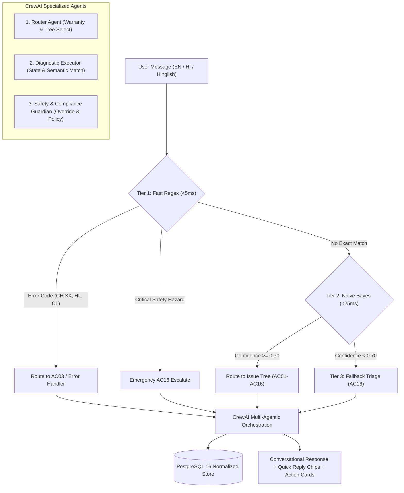

# LG AC Intelligent Conversational Pre-Diagnostic Chatbot (Phase 2)
## Master Architecture & Implementation Plan

> **Project:** LG AC Intelligent Conversational Pre-Diagnostic Chatbot  
> **Architecture:** 3-Tier Laya Local Intent Engine + CrewAI Multi-Agentic Orchestration + PostgreSQL + Node.js/Express + React/TypeScript  
> **Status:** Phase 2 Implementation Active  
> **Target Appliance:** LG 1.5-Ton Dual Inverter Series (Primary: UW-Q18WUZA, Secondary: MS-Q18YNZA)  

---

## 1. Executive Blueprint & Conversational Pipeline

Phase 2 transitions the diagnostic experience from a rigid questionnaire wizard to an **intelligent conversational agentic chatbot**. The chatbot understands natural language in **English, Hindi, and Hinglish**, maintains conversational session state, and navigates the 16 verified LG AC decision trees (`AC01`–`AC16`) using zero-latency local intent classification and semantic option matching.



---

## 2. Source-of-Truth Knowledge Base Manifest

| Source File | Content & Role | Safety & Compliance Rule |
| :--- | :--- | :--- |
| `lg_ac_diagnostic_trees_combined.json` | 16 verified issue trees (`AC01`–`AC16`) with nodes, bilingual text (`text_en`, `text_hi`), options, actions, conclusions. | Must never hallucinate new nodes or invent branching logic. |
| `lg_ac_error_codes.json` | 28 official LG error codes with customer vs technician actions, likely parts, and severity. | Customer action must never recommend opening unit or probing circuits. |
| `manual_disassembly_maintenance.txt` | Strict boundaries for User-Safe maintenance (filter cleaning, grille wash) vs Technician-Only disassembly (indoor blower, evaporator coil, PCB, outdoor fan). | DIY advice strictly confined to User-Safe tasks. All internal maintenance requires certified dispatch. |
| `troubleshooting_error_codes.txt` | Deep technician troubleshooting steps, multimeter test procedures, and unverified spec warnings. | Gate technician procedures behind Technician Auth. |
| `warranty_policy_rules.txt` | India LG Warranty Rules: 1-Year Comprehensive, 10-Year Inverter Compressor (requires registration), PCB warranty terms, exclusions (gas leak after yr 1, physical damage, lightning). | Must append disclaimer: *"Warranty coverage is indicative and subject to physical verification of invoice and unit by authorized engineer."* |
| `manual_electrical_specs.txt` | Resistance & voltage benchmarks (e.g. thermistors 10kΩ/5kΩ, motor windings 1.2–2.5Ω, DC Link 310–380V). | **CRITICAL:** UNVERIFIED VALUES. NEVER display to customers. Gate behind Technician Auth + Disclaimer Banner. |

---

## 3. Task Breakdown & Execution Roadmap

### Task 1: "Laya" Lightweight Local Intent Classifier (Node.js)
- **Zero Cloud LLM calls** for initial routing, maintaining sub-30ms response times.
- **Tier 1 (Regex < 5ms):**
  - Detect error codes: `/\b(ch\s?\d{1,2}|cl|fl|hl|po|lo|hi|od|e\d)\b/i` &rarr; routes directly to `AC03` or exact error node.
  - Critical hazard detection: `smoke`, `spark`, `fire`, `burning smell`, `electric shock`, `shock lag raha`, `blast`.
- **Tier 2 (Naive Bayes < 25ms):**
  - Trained on ALL `text_en` and `text_hi` question strings, titles, and option labels from `lg_ac_diagnostic_trees_combined.json`.
  - Expanded Hinglish dictionary (e.g. `thanda nahi`, `paani tapak`, `awaaz`, `barf jam`, `garam hawa`).
  - Classifies user inputs into `AC01` through `AC16`.
- **Tier 3 (Fallback < 50ms):**
  - If confidence $< 0.70$, routes to `AC16` (Hardware Failure & General Triage).
- **Output Schema:**
  ```typescript
  export interface LayaClassificationResult {
    intent_type: 'ERROR_CODE' | 'CRITICAL_SAFETY' | 'SYMPTOM_TREE' | 'TRIAGE_FALLBACK' | 'WARRANTY' | 'MAINTENANCE';
    target_tree_id: string; // 'AC01' - 'AC16'
    confidence: number;
    extracted_entities: {
      errorCode?: string;
      safetyHazard?: string;
      symptomPhrase?: string;
      language?: 'en' | 'hi' | 'hinglish';
      matchedNodeId?: string;
    };
  }
  ```

---

### Task 2: CrewAI Orchestration Layer (Python / Microservice)
Three specialized agents operating sequentially:

1. **Router Agent:**
   - Evaluates classifier output and selects target tree.
   - Pre-checks warranty eligibility against PostgreSQL database.
   - Sets initial session context (`session_id`, `issue_id`, `start_node`).

2. **Diagnostic Executor Agent:**
   - Manages conversational turns.
   - Fetches active node from database.
   - Maps user free-text answers to discrete node options using semantic similarity.
   - Injects Rich Action Cards from `manual_disassembly_maintenance.txt` when an action is triggered (e.g. `instruct_clean_dry_filter`).
   - Progresses to `next_node`, `redirect_issue`, or `conclusion`.

3. **Safety & Compliance Guardian Agent:**
   - Evaluates every turn for hazard language or unauthorized customer DIY attempts (e.g. touching capacitor, cutting wires, opening compressor box).
   - Enforces immediate override: stops diagnostic flow, marks `safety_flag: true`, triggers emergency power shutdown instructions, and forces dispatch.
   - Ensures all conclusions use probabilistic phrasing (*"The likely cause is..."* instead of *"The problem IS..."*).

---

### Task 3: PostgreSQL Normalized Schema & Seeding Script
A fully normalized, relational schema in PostgreSQL 16:

1. `diagnostic_issues`: Issue trees (`AC01` to `AC16`) with titles, descriptions, start nodes.
2. `diagnostic_nodes`: Tree nodes with `type`, `text_en`, `text_hi`, and safety flags.
3. `node_options`: Options linking nodes with `next_node`, `redirect_issue`, `action`, `conclusion`.
4. `conclusions`: Diagnostic outcomes with `probable_cause`, `confidence`, `priority`, `safety_flag`, `technician_note`.
5. `conclusion_parts`: Many-to-many relationship of conclusions to required replacement parts.
6. `error_codes`: 28 official LG error codes with customer actions, technician actions, severity.
7. `users`: Customers, Technicians, and Admin accounts with hashed credentials.
8. `technicians`: Profile info, employee codes (`AC-EMP-...`), ratings, master certifications.
9. `technician_availability`: Slots for the 10-technician city fleet across morning, afternoon, and evening windows.
10. `tickets`: Full service request records with pre-filled telemetry, customer address, assigned technician, status.
11. `warranty_records`: Product registration and compressor coverage verification rules.

**Seeding Pipeline:**
- Script parses `lg_ac_diagnostic_trees_combined.json` and `lg_ac_error_codes.json`.
- Preserves all bilingual strings, redirect references, action tags, and safety flags.
- Seeds admin, demo customer, and 10 certified technicians.

---

### Task 4: Conversational Chatbot Frontend (React + TypeScript)
Replaces the traditional MCQ questionnaire with an interactive chat interface:
- **Message Bubbles:** Left/teal for Bot, Right/slate for User.
- **Quick Reply Chips:** Rendered directly underneath bot questions using the current node's options to allow 1-tap answering while accepting natural typing.
- **Rich Action Cards:** Embedded step-by-step visual cards for safe DIY tasks (e.g. 4-step filter cleaning) with safety warnings.
- **Progress Telemetry:** Step indicator (Step $N$ of estimated depth).
- **Persistent Escape Hatch:** Always-visible *"Request Technician Visit"* button.
- **Language Switcher (EN / HI):** Real-time toggle switching question text and chip labels without losing session progress.
- **Session Persistence:** Retained across page refreshes via LocalStorage and session tokens.

---

### Task 5: Service Booking & Multi-Role Scheduling System
- **Role-Based Access Control (RBAC):**
  - **Customer:** Self-register/login, run diagnostics, book service with pre-filled findings, track status.
  - **Technician:** Admin-created credentials only, view assigned tickets, access gated electrical benchmarks, update ticket to `IN_PROGRESS` and `RESOLVED`.
  - **Admin:** Single master credential (`admin@appliancecare.ai` / `admin123`), fleet telemetry, ticket dispatch queue, and **Technician Provisioning Module**.
- **Scheduling Engine:**
  - Queries `technician_availability` for the 10-technician fleet.
  - Assigns first available certified engineer matching the requested slot.

---

## 4. Safety & Compliance Mandates

1. **Gate Unverified Electrical Specs:** Values from `manual_electrical_specs.txt` are strictly hidden from customers. Exposed only to authenticated technicians behind an explicit disclaimer banner.
2. **Safety Flag Enforcement:** Any node or conclusion with `safety_flag: true` triggers an immediate lock on DIY instructions and forces booking.
3. **Probabilistic Language:** Diagnostic findings must state *"The probable cause is..."* or *"Likely failure detected in..."*.
4. **Hinglish Coverage:** Classifier trained on bilingual text and common colloquial phrasing.
5. **Warranty Disclaimers:** All coverage statements must note that final warranty validity is subject to physical invoice verification.
