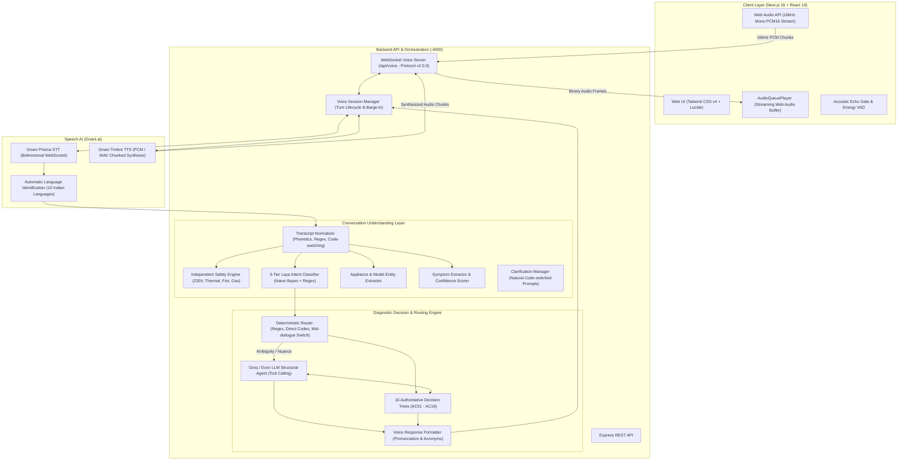

# 🎙️ ApplianceCare AI — Real-Time Voice Diagnostic & Multi-Modal Support Platform

[](https://www.typescriptlang.org/)
[](https://nextjs.org/)
[](https://react.dev/)
[](https://nodejs.org/)
[](https://tailwindcss.com/)
[](https://datatracker.ietf.org/doc/html/rfc6455)
[](LICENSE)

**ApplianceCare AI** is an enterprise-grade, low-latency pre-diagnostic platform for home appliances. It features a bidirectional, real-time voice streaming pipeline with conversational code-switching (Tamil-English, Hinglish, Indian English), authoritative zero-hallucination diagnostic decision trees, automatic error code disambiguation, independent safety gating, warranty validation, and automated technician scheduling.

---

## 📑 Table of Contents
1. [System Overview & Primary Use Cases](#1-system-overview--primary-use-cases)
2. [End-to-End System Architecture](#2-end-to-end-system-architecture)
3. [Comprehensive Technology Stack](#3-comprehensive-technology-stack)
4. [Deep-Dive Implementation Details](#4-deep-dive-implementation-details)
   - [A. Web Audio API & Acoustic Echo Gate](#a-web-audio-api--acoustic-echo-gate)
   - [B. Binary Framing Protocol v2.0.0](#b-binary-framing-protocol-v200)
   - [C. Conversation Understanding & Intent Triage](#c-conversation-understanding--intent-triage)
   - [D. Deterministic Decision Trees & Universal Switching](#d-deterministic-decision-trees--universal-switching)
   - [E. LLM Tool Calling & Zero Static Few-Shot Policy](#e-llm-tool-calling--zero-static-few-shot-policy)
   - [F. Multilingual Code-Switching & Speech AI](#f-multilingual-code-switching--speech-ai)
   - [G. Role-Based Safety Guardian](#g-role-based-safety-guardian)
5. [Complete API & WebSocket Reference](#5-complete-api--websocket-reference)
6. [Appliance & Decision Tree Coverage](#6-appliance--decision-tree-coverage)
7. [Quickstart: Local Development](#7-quickstart-local-development)
8. [Environment Variable Configuration](#8-environment-variable-configuration)
9. [Automated Verification & Auditing Suites](#9-automated-verification--auditing-suites)
10. [Production Deployment & Operational Runbook](#10-production-deployment--operational-runbook)

---

## 1. System Overview & Primary Use Cases

### The Problem
Traditional appliance customer service relies on static IVRs or generic chatbots that hallucinate troubleshooting instructions, give dangerous high-voltage advice to non-technical homeowners, force customers into unnatural formal languages, and fail to distinguish between symptoms (e.g. *AC not cooling*) and error codes (e.g. *CH 05*).

### The Solution: ApplianceCare AI
ApplianceCare AI bridges customer speech and verified manufacturer diagnostics with:
1. **Hands-Free Phone-Like Experience**: Sub-second voice conversation in the browser with real-time speech-to-text (STT), text-to-speech (TTS), and hardware-level acoustic echo cancellation.
2. **Conversational Code-Switching**: Local support executive persona speaking natural Tamil mixed with English (*Tanglish*), Hindi mixed with English (*Hinglish*), or Indian English, retaining technical vocabulary (*cooling, compressor, PCB, filter, remote*) without robotic translations.
3. **Zero-Hallucination Diagnostic Trees**: 16 manufacturer-verified decision trees (`AC01`–`AC16`) backed by graph validation. No LLM ever invents a symptom, test, or error code.
4. **Universal Mid-Dialogue Symptom Correction**: If a user is answering questions about cooling performance and suddenly mentions *"sorry sorry it's MCB tripping"*, the system immediately pre-empts and transitions to electrical safety (`AC03`), preventing misrouting into *No Power* (`AC02`).
5. **Role-Based Safety Isolation**: Strict boundary between safe customer actions (mesh filter washing, remote mode reset, circuit breaker reset) and gated technician actions (230V live multimeter probing, capacitor discharge, R32 refrigerant manifold gauges).
6. **Unified Error Code Disambiguation**: Phonetic and syntactic recognition for 34 verified `CH` error codes (`"c h zero five"` &rarr; `CH05`), protecting against namespace collisions between trees (`AC01`) and codes (`CH01`).
7. **End-to-End Service Lifecycle**: Automatic warranty validation (1-yr comprehensive, 5-yr PCB, 10-yr inverter compressor), parts recommendation, and technician dispatch across 10 specialized service engineers.

---

## 2. End-to-End System Architecture

The platform operates on a reactive, decoupled multi-tier architecture:



---

## 3. Comprehensive Technology Stack

| Layer | Technology | Version | Purpose & Responsibilities |
| :--- | :--- | :--- | :--- |
| **Frontend Framework** | **Next.js** | `16.4.0` | App Router, Server/Client components, Turbopack bundling, responsive SSR. |
| **UI Library** | **React** | `19.0.0` | Declarative UI state, audio node lifecycle management, modal dialogs. |
| **Styling & Icons** | **Tailwind CSS / Lucide** | `v4.0` / `0.454` | Modern zero-runtime design system, hardware-accelerated animations, responsive UI. |
| **Audio Capture** | **Web Audio API** | Standard | `AudioContext`, `MediaStreamTrack`, `ScriptProcessorNode` / `AudioWorklet` (16kHz PCM16). |
| **Backend Runtime** | **Node.js** | `>= 20.0` | Asynchronous I/O, binary stream processing, microsecond-level dispatching. |
| **Backend Framework** | **Express** | `4.19.2` | RESTful API endpoints, CORS handling, rate-limiting, and upload handling. |
| **WebSocket Engine** | **ws** | `8.22.0` | High-throughput RFC 6455 WebSocket server supporting Binary Protocol v2.0.0. |
| **Schema Validation** | **Zod** | `3.23.8` | Resilient runtime schema validation for REST payloads and WebSocket frames. |
| **NLP & Classification** | **Natural** | `8.1.1` | Naive Bayes classifier trained on 16 diagnostic issue trees (Bilingual EN/HI/Hinglish). |
| **LLM Inference (Cloud)**| **Groq SDK** | `1.6.0` | Ultrafast structural tool-calling (`llama-3.3-70b-versatile`, `qwen-2.5-32b`). |
| **LLM Inference (Local)**| **Hugging Face** | Endpoint | Self-hosted `gnani/gnani-evon-v3.3-30B-A3B` via OpenAI-compatible chat API. |
| **Speech-to-Text (STT)**| **Gnani Prisma** | WebSocket | Real-time bidirectional streaming ASR with 10 Indian language LID. |
| **Text-to-Speech (TTS)**| **Gnani Timbre** | Streaming | Low-latency voice synthesis with phonetic acronym expansion. |
| **Database & Vector** | **PostgreSQL / pgvector**| `0.3.0` | Relational diagnostic persistence, RRF hybrid lexical/vector chunk retrieval. |
| **Testing Harness** | **ts-node / TypeScript** | `5.5.2` | Granular unit tests, latency benchmarks, and 157-case master voice suite. |

---

## 4. Deep-Dive Implementation Details

### A. Web Audio API & Acoustic Echo Gate
Modern browsers enforce strict autoplay restrictions on Web Audio:
1. **User Gesture Unlocking**: `AudioContext` is created or resumed synchronously during the user click handler (`VoiceCallModal.tsx` or `DiagnosticEngine.tsx`), playing a 1-sample silent buffer to unlock the audio hardware before any network frames arrive.
2. **AudioQueuePlayer**: Manages a double-buffered queue of synthesized PCM/WAV chunks, tracking active audio duration and dispatching `playback_complete` events.
3. **Acoustic Loopback Suppression (Echo Gate)**: Browser microphones capture speaker output, which would otherwise feed back into the STT engine. The frontend and backend enforce:
   - Energy-based Voice Activity Detection (VAD) with RMS silence gating.
   - An Echo Gate that holds a suppression window during active speech playback plus 350ms of room reverberation decay.
   - Assistant speech acoustic fingerprinting to prevent self-triggering barge-in.

### B. Binary Framing Protocol v2.0.0
Real-time audio over WebSocket utilizes a 16-byte fixed binary header followed by raw PCM16 payload:

```
 0                   1                   2                   3
 0 1 2 3 4 5 6 7 8 9 0 1 2 3 4 5 6 7 8 9 0 1 2 3 4 5 6 7 8 9 0 1
+-+-+-+-+-+-+-+-+-+-+-+-+-+-+-+-+-+-+-+-+-+-+-+-+-+-+-+-+-+-+-+-+
|          Magic (0x4147)       |    Version    |     Flags     |
+-+-+-+-+-+-+-+-+-+-+-+-+-+-+-+-+-+-+-+-+-+-+-+-+-+-+-+-+-+-+-+-+
|                      Sequence Number (u32)                    |
+-+-+-+-+-+-+-+-+-+-+-+-+-+-+-+-+-+-+-+-+-+-+-+-+-+-+-+-+-+-+-+-+
|                            Turn ID (u32)                      |
+-+-+-+-+-+-+-+-+-+-+-+-+-+-+-+-+-+-+-+-+-+-+-+-+-+-+-+-+-+-+-+-+
|        Sample Rate (u16)      |          Payload Length       |
+-+-+-+-+-+-+-+-+-+-+-+-+-+-+-+-+-+-+-+-+-+-+-+-+-+-+-+-+-+-+-+-+
|                         PCM16 Payload Data                    |
|                               ...                             |
+-+-+-+-+-+-+-+-+-+-+-+-+-+-+-+-+-+-+-+-+-+-+-+-+-+-+-+-+-+-+-+-+
```
- **Magic**: `0x4147` ("AG" - ApplianceCare Gateway).
- **Version**: `0x02` (Protocol 2.0.0).
- **Flags**: Bit 0: IsVoiced, Bit 1: IsEndOfTurn, Bit 2: BargeInInterrupt.
- **Turn ID**: Increments with every user conversational turn. Obsolete chunks from interrupted turns are discarded at byte zero.

### C. Conversation Understanding & Intent Triage
User utterances pass through a multi-stage understanding pipeline:
1. **Transcript Normalizer (`transcriptNormalizer.ts`)**:
   - Expands colloquial spoken phrases into canonical terminology (`"ac cooling varala"` &rarr; `"ac not cooling"`, `"paani gir raha hai"` &rarr; `"water leakage"`).
   - Normalizes spaced error codes (`"c h 0 5"` &rarr; `CH05`, `"p c b"` &rarr; `PCB`, `"m c b"` &rarr; `MCB`).
2. **Safety Engine (`safetyEngine.ts`)**:
   - Detects life-safety events (`smoke`, `spark`, `fire`, `burning smell`, `electric shock`).
   - Immediately bypasses all diagnostic questioning, halts voice playback, and commands immediate power isolation.
3. **Intent Classifier (`intentClassifier.ts`)**:
   - 3-tier classification: Fast Regex (<5ms) &rarr; Naive Bayes (<25ms) &rarr; LLM Ambiguity Resolution.
   - Categorizes utterances into `DIAGNOSIS`, `ERROR_CODE`, `BOOKING`, `WARRANTY`, `AUDIBILITY_CHECK`, `LANGUAGE_COMMAND`, or `GENERAL_SUPPORT`.
4. **Clarification Manager (`clarificationManager.ts`)**:
   - Evaluates whether essential parameters (symptom, duration, error code) are missing.
   - When clarification is needed, generates natural code-switched questions without archaic words (*never uses "சாதனத்தில்" or "उपकरण"*).

### D. Deterministic Decision Trees & Universal Switching
The system enforces 16 authoritative decision trees (`AC01`–`AC16`):
- Every step is a state machine node with verified bilingual questions (`text_en`, `text_hi`) and deterministic options (`label`, `next_node`, `redirect_issue`, `resolution`, `conclusion`).
- **Universal Mid-Dialogue Symptom Correction**:
  - In an active tree (e.g. `AC01` node `q1_power_check`), if the user says:
    ```
    User: "sorry sorry it's MCB tripping"
    ```
  - `deterministicRouter.ts` identifies the explicit correction signal (`sorry`, `actually`) and matches `AC03` with 0.88 confidence.
  - Rather than mapping to Option 1 ("No, AC is not on") which would redirect to *No Power* (`AC02`), the engine immediately pivots to `AC03` (MCB Tripping) and issues an empathetic confirmation.

### E. LLM Tool Calling & Zero Static Few-Shot Policy
LLM reasoning (Groq / Hugging Face Evon 30B) strictly operates via **Structural Tool Calling**:
- Exposed tools:
  - `advance_diagnostic_step(option_index, conversational_reply)`
  - `start_diagnostic_tree(tree_id, conversational_reply)`
  - `clarify_symptom(clarification_question)`
  - `escalate_to_technician(reason)`
  - `answer_general_appliance_query(answer)`
- **Zero Static Few-Shot Policy**: System prompts NEVER contain verbatim sample dialogues. LLMs overfit to few-shot templates and parrot them mechanically. Instead, prompts govern linguistic principles, persona, technical terminology retention, and dynamic reasoning.

### F. Multilingual Code-Switching & Speech AI
A permanent speaking policy governs speech generation:
- **Tamil-English (Tanglish)**: Natural conversational Tamil mixed with English (*"சரி, AC on ஆகுதா?", "Outdoor unit ஓடுதா?"*).
- **Hindi-English (Hinglish)**: Natural conversational Hindi mixed with English (*"Achha, AC on ho raha hai?", "Cooling bilkul nahi aa rahi hai kya?"*).
- **Technical Vocabulary**: Retained in English (*cooling, compressor, fan, remote, display, filter, outdoor unit, temperature, voltage, MCB, PCB*).
- **Phonetic Pronunciation Dictionary (`ttsPronunciationDictionary.json`)**:
  - `CH05` &rarr; `"C H zero 05"`
  - `PCB` &rarr; `"P C B"`
  - `MCB` &rarr; `"M C B"`
  - `₹499` &rarr; `"499 rupees"`
  - `R32` &rarr; `"R thirty-two"`

### G. Role-Based Safety Guardian
| Feature | Customer View | Technician Portal |
| :--- | :--- | :--- |
| **Visible Actions** | Filter washing, grill inspection, remote reset, wall plug reset. | PCB DC-link testing, thermistor resistance curves, nitrogen pressure checks. |
| **Voltage Boundaries**| Blocked from all internal cabinet disassembly or live probing. | 230V AC mains & 310V DC bus schematics exposed with safety disclaimers. |
| **Error Code CH05** | Recommended power cycle; if persistent, booking recommended. | Step-by-step 28V DC communication waveform verification at terminal block. |

---

## 5. Complete API & WebSocket Reference

### REST Endpoints

#### `POST /api/chat/session`
Initializes or retrieves an ongoing chat session. Resilient against `null` or missing payload attributes.
```json
// Request Body
{
  "sessionId": "optional-uuid",
  "model": "UW-Q18WUZA",
  "language": "en",
  "appliance": "air-conditioner"
}
```

#### `POST /api/chat/message`
Dispatches a text utterance, option click, or direct tree launch.
```json
// Request Body
{
  "sessionId": "49557b7f-bcfb-4a57-b4d4-53cba39aa734",
  "text": "my ac is not cooling",
  "optionIndex": 0,
  "issueId": "AC01"
}
```

#### `GET /api/error-codes/:code`
Looks up an official LG error code (e.g. `CH05`, `CH38`, `CL`).

#### `GET /api/warranty/check?model=UW-Q18WUZA&purchaseDate=2024-05-10`
Calculates comprehensive, PCB, and compressor warranty validity.

#### `GET /api/technicians`
Returns the roster of 10 certified service engineers with availability schedules.

---

### WebSocket Voice Protocol (`/api/voice`)

#### Client &rarr; Server Messages
- `start_session`: Handshake declaring `sessionId`, `model`, `appliance`, and `language` (`AUTO_DETECT`, `en-IN`, `ta-IN`, `hi-IN`).
- Binary Frames: 16-byte header + 16kHz PCM16 audio chunks.
- `barge_in`: Dispatched when the user interrupts speech.
- `heartbeat`: Keep-alive ping sent every 15 seconds.

#### Server &rarr; Client Messages
- `session_ready`: Acknowledges connection with session state and protocol version `2.0.0`.
- `transcript`: Streams interim and final normalized customer utterances.
- `bot_message`: JSON payload containing structured text, options, and diagnostic cards.
- Binary Audio Frames: 16-byte header + synthesized TTS audio chunks.
- `playback_complete`: Signals end of speech synthesis for the current turn.

---

## 6. Appliance & Decision Tree Coverage

### 16 LG Dual Inverter Air Conditioner Decision Trees
- **AC01**: Cooling Performance & Warm Air Flow
- **AC02**: Power Failure & No Display / Won't Turn On
- **AC03**: MCB Tripping & Electrical Short Circuit Safety
- **AC04**: Indoor Water Leakage & Drain Overflow
- **AC05**: Abnormal Odor & Burning Smell Detection
- **AC06**: Abnormal Noise & Outdoor Fan Vibration
- **AC07**: Airflow & Blower Motor Weakness
- **AC08**: Remote Controller Malfunction
- **AC09**: Ice Formation & Evaporator Coil Freezing
- **AC10**: Inverter Compressor Frequent Cycling
- **AC11**: Display Flickering & LED Blinking Codes
- **AC12**: Air Filter Wash Reminder & Maintenance (FL Code)
- **AC13**: Room Temperature Thermistor & Sensor Fault
- **AC14**: Physical Enclosure & Front Grille Damage
- **AC15**: ThinQ Smart App & Wi-Fi Pairing
- **AC16**: Critical Hardware Failure & Emergency Safety Shutdown

### Refrigerators & Washing Machines
- Double-Door Frost-Free (`GL-N292RDSY`): Defrost heater failure, damper motor blockage, and fresh food compartment warming.
- Single-Door Direct Cool (`GL-D201ABCD`): Thermal overload protector, PTC relay, and door gasket seal leaks.
- Washing Machines (Front/Top Load): Drain pump filter clog (OE), unbalanced load walking (UE), water inlet valve (IE), and door thermal lock timeout.

---

## 7. Quickstart: Local Development

### Prerequisites
- Node.js `>= 20.0.0`
- npm `>= 10.0.0`

### Step 1: Install Dependencies
```powershell
# Install backend dependencies
cd backend
npm install

# Install frontend dependencies
cd ../frontend
npm install
```

### Step 2: Configure Environment
Copy `.env.example` in both directories:
```powershell
# In backend/
copy .env.example .env

# In frontend/
copy .env.local.example .env.local
```

### Step 3: Start the Backend API & Voice Server
```powershell
cd backend
npm run dev
```
> Server runs on `http://localhost:4000`  
> WebSocket voice endpoint: `ws://localhost:4000/api/voice`

### Step 4: Start the Frontend Application
```powershell
cd frontend
npm run dev
```
> Open your browser to `http://localhost:3000`

---

## 8. Environment Variable Configuration

### Backend (`backend/.env`)
| Variable | Required | Description | Default |
| :--- | :--- | :--- | :--- |
| `PORT` | Yes | HTTP & WebSocket server port | `4000` |
| `FRONTEND_URL` | Yes | Allowed CORS origin | `http://localhost:3000` |
| `GROQ_API_KEY` | Optional | Groq Cloud API key for ultra-fast tool calling | `gsk_...` |
| `GROQ_MODEL` | Optional | Groq Model ID | `llama-3.3-70b-versatile` |
| `GNANI_API_KEY` | Optional | Gnani.ai API key for Prisma STT & Timbre TTS | `your_key` |
| `HF_TOKEN` | Optional | Hugging Face access token for Evon 30B | `hf_...` |
| `HF_LLM_BASE_URL` | Optional | OpenAI-compatible endpoint for Evon 30B | `http://localhost:8000/v1` |
| `DATABASE_URL` | Optional | PostgreSQL connection string | `postgresql://...` |

### Frontend (`frontend/.env.local`)
| Variable | Required | Description | Default |
| :--- | :--- | :--- | :--- |
| `NEXT_PUBLIC_API_URL` | Yes | Backend REST API URL | `http://localhost:4000` |
| `NEXT_PUBLIC_VOICE_WS_URL` | Optional | Custom WebSocket URL | `ws://localhost:4000/api/voice` |

---

## 9. Automated Verification & Auditing Suites

The repository contains automated test suites ensuring zero regressions:

### 1. Master Production Voice Reliability Suite (157 Tests)
Verifies audio framing, VAD, state machine transitions, barge-in interruption, session recovery, binary protocol v2.0.0, pronunciation expansion, multilingual routing, audibility checks, language commands, and mid-dialogue symptom corrections:
```powershell
cd backend
npm run test:voice:suite
```
```
======================================================================
TOTAL AUDITED TESTS: 157
PASSED: 157 (100%)
FAILED: 0
======================================================================
```

### 2. Core Diagnostic & Intent Audit Suite (16 Tests)
Validates decision tree connectivity, error code resolution, lethal voltage safety isolation, and lexical/vector retrieval:
```powershell
cd backend
npm test
```
```
======================================================================
TOTAL: 16 / 16 PASSED (100%)
======================================================================
```

### 3. TypeScript Compilation Checks
```powershell
# Compile backend TypeScript
npm --prefix backend run build

# Typecheck frontend Next.js App
npx --prefix frontend tsc --noEmit -p frontend/tsconfig.json
```

---

## 10. Production Deployment & Operational Runbook

### Production Build & Containerization
```powershell
# Build backend
cd backend
npm run build
npm start

# Build frontend
cd ../frontend
npm run build
npm start
```

### Operational Invariants & Guidelines
1. **Never solve, click through, or bypass security boundaries**: Keep API keys protected in server-side environment variables.
2. **Deterministic Precedence**: If a customer mentions an explicit error code or safety risk, deterministic routing pre-empts all generative LLM responses.
3. **Audio Autoplay Compliance**: Always ensure the Web Audio `AudioContext` is unlocked via user gesture before initializing streaming playback.
4. **Session Payload Resiliency**: Ensure `/api/chat/session` gracefully transforms missing or null parameters into valid fallback models (`UW-Q18WUZA`, `air-conditioner`, `en`).

---

## 📄 License
This project is licensed under the MIT License. See [LICENSE](LICENSE) for details.
